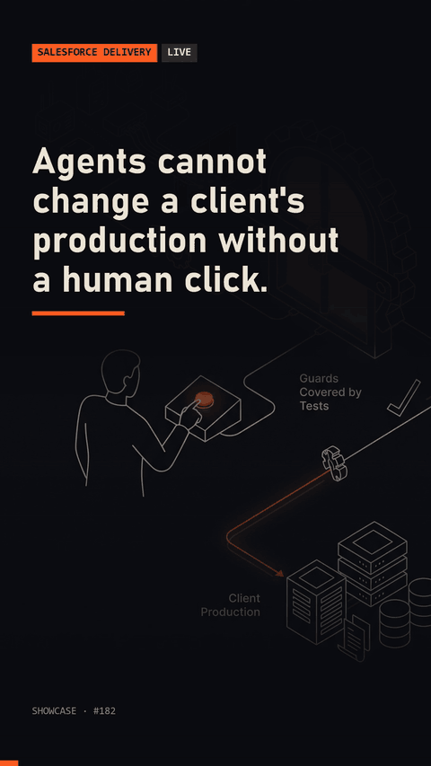

# prod-lockdown-guards

Production lockdown guards for agent-driven Salesforce work: writes to production blocked by default, wait-for-human-click flow, reads allowed, and a bypass test suite.



## Quick start

```
node demo.mjs
```

Tests: `node --test test/lockdown.test.mjs`

## Requirements

Node 18+. No dependencies. The Salesforce CLI is only needed if you wire the hook to a real agent; the demo and tests never call it.

## How it works

- A Claude Code `PreToolUse` hook (`src/hook.mjs`) parses each shell command, splits chains (`&&`, `;`, `|`) and classifies every `sf`/`sfdx` call as read, deploy, data, apex, permission or destructive.
- Reads and check-only runs (`--dry-run`, `validate`) always pass. Anything not known to be read-only counts as a write.
- A write passes only for orgs listed under `sandboxes` in `lockdown.config.json`. Named production orgs, unknown aliases and commands with no org are all treated as production.
- A blocked write creates a pending request. A human opens the approval page (`node src/click-server.mjs`) and clicks Approve; that unlocks exactly one run of that exact command for two minutes.
- `test/lockdown.test.mjs` covers bypass attempts: chaining, pipes, flag spellings, case, unknown aliases, expired and reused approvals.

Hook wiring (`settings.json`):

```json
{"hooks": {"PreToolUse": [{"matcher": "Bash", "hooks": [{"type": "command", "command": "node src/hook.mjs"}]}]}}
```

Limit: this guards what the agent runs through the hook. It does not replace org-level permissions.

## License

MIT. See [LICENSE](LICENSE).

Built with Claude Code. More: https://made-by-asking.pages.dev/showcase/prod-lockdown-guards/
